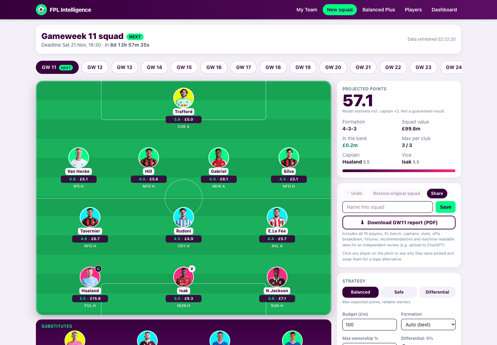
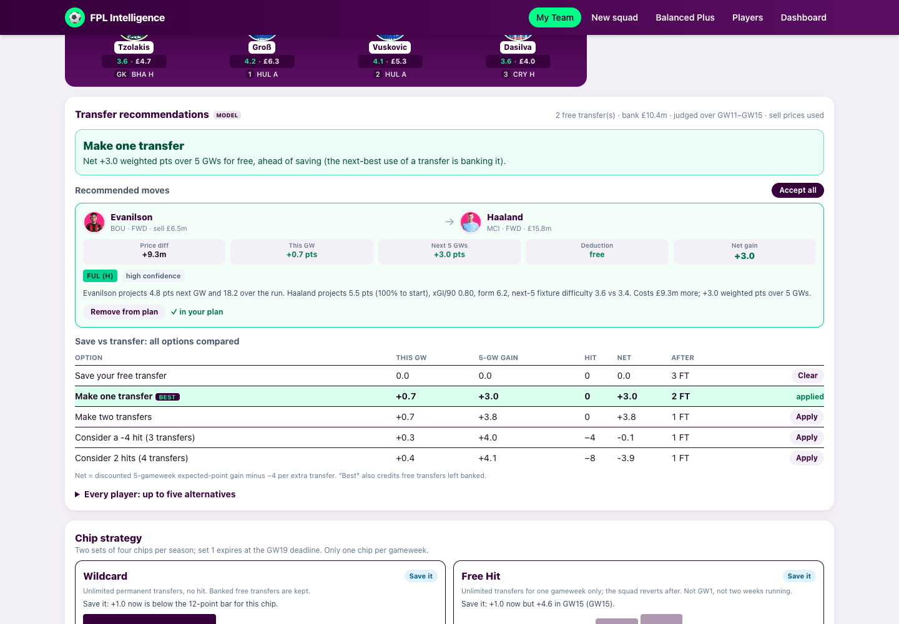

# FPL Intelligence

AI-assisted Fantasy Premier League squad builder. It pulls live data from the (unofficial) FPL API, projects **expected points per player per gameweek** with a transparent, deterministic model, then uses **integer linear programming** to pick the best legal 15-man squad, XI, formation, bench order, captain and vice-captain. Every pick is explained, every swap is validated, and the model is backtested against actual results.

> The squad is chosen by a solver, never by an LLM. An LLM could be layered on top later purely for narrative explanations.



## Quick start

```bash
npm install
npm run dev          # http://localhost:3000  → lands on the NEXT gameweek automatically
# or production:
npm run build && npm start
```

Requires Node 20+. No database, accounts or API keys. If the FPL API is unreachable the app serves the last good in-memory/disk snapshot, then a bundled sample, and shows a "older data" banner.

| Command | What it does |
|---|---|
| `npm test` | 224 unit/integration tests (Vitest) |
| `npm run typecheck` | `tsc --noEmit` |
| `npm run backtest` | Point-in-time backtest vs actual points, writes `docs/backtest-results.json` |
| `npm run screenshots` | End-to-end walkthrough of the New squad builder in headless Chrome (asserts the flow) and regenerates `docs/screenshots/` |
| `npm run backtest:verify-data` | Offline: re-hash the frozen historical snapshots against `data/historical/manifest.json` |
| `npm run backtest:bp` | Rolling historical backtest of all four strategies (frozen real data in `data/historical`; writes `docs/backtest/*`) |
| `npm run e2e:balanced-plus` | Browser E2E for the Balanced Plus page: comparison table, explanations, PDF download validated against the page |
| `npm run balanced-plus` | Generates the Balanced Plus Gameweek Intelligence Report PDF (`docs/samples/`) |
| `npm run e2e:report` | **Final E2E**: clicks *Download GW report* in Team Builder and My Team (incl. Free Hit) in Chrome and validates the downloaded PDF against what was on screen |
| `npm run e2e:season` | End-to-end walkthrough of the Season Manager (import errors, accept/restore, replace, chips, plan ahead, lock-in, predicted vs actual, persistence, mobile) |

**Download GW report (PDF)** is available in both modes: a Gameweek Intelligence Report for the exact squad on screen, with selectable text and machine-readable JSON for an independent review (e.g. ChatGPT). See [docs/GW_REPORT.md](docs/GW_REPORT.md).

**Balanced Plus** is a fourth strategy (max 2 per club in the XI, secure minutes, five-gameweek xG/xA value, no form tilt, strong bench, independent captaincy) with its own PDF report and a comparison against the other three: [docs/BALANCED_PLUS.md](docs/BALANCED_PLUS.md). A rolling historical backtest found it **competitive but with no established advantage** over Balanced ([audit](docs/BALANCED_PLUS_AUDIT.md), [backtest](docs/BALANCED_PLUS_BACKTEST.md)).

## Two modes

- **New squad** (`/team-builder`): generate a fresh 15-player squad for any gameweek. Unchanged.
- **My Team** (`/my-team`, Season Manager): import your FPL team by ID, keep your squad across gameweeks, track free transfers, bank and **selling prices**, get transfer / save recommendations (including "do nothing"), plan Wildcard, Free Hit, Bench Boost and Triple Captain, and compare predicted vs actual points. Rules verified for 2026/27: see [docs/SEASON_MANAGER.md](docs/SEASON_MANAGER.md).



## The flow (New squad)

**Open app → next gameweek → data fetched → players analysed → squad optimised → pitch shown → click a player → swap → everything recalculates.**

1. `/` redirects to `/team-builder?gw=<next gameweek>` and auto-generates a squad.
2. Pick any upcoming gameweek (GW selector), a strategy (Balanced / Safe / Differential), budget, formation, ownership cap, differential preference, "favour fixture runs".
3. Click any player: **Why selected** (reasons, warnings, xPts breakdown) and **Replace** (only legal swaps, with Δ squad points, price change, xG/xA, minutes, form, next fixture + FDR, start %, ownership).
4. Swap in a player → `/api/evaluate` re-derives XI, formation, captain and points; changed players are ringed; **Undo** and **Restore original squad** are available.
5. **Save** (local), **Share** (stateless URL + 1200×630 PNG), compare saved versions on the Dashboard.

Other pages: `/dashboard` (deadline countdown, freshness, saved teams, model accuracy), `/players` (search, filter, sort, compare up to 3), `/player/[id]` (stats, recent form chart, consistency, next 6 fixtures with projections), `/share?d=…` (read-only share view, no login).

## Deployment

Deployable to Vercel as-is (no database, no environment variables): see [docs/DEPLOYMENT.md](docs/DEPLOYMENT.md).

## Documentation

| Doc | Contents |
|---|---|
| [docs/BALANCED_PLUS_AUDIT.md](docs/BALANCED_PLUS_AUDIT.md) · [docs/BALANCED_PLUS_BACKTEST.md](docs/BALANCED_PLUS_BACKTEST.md) | Pre-backtest audit and data-availability assessment; rolling backtest of all four strategies with statistics, sensitivity, limitations and recommendation |
| [docs/BALANCED_PLUS.md](docs/BALANCED_PLUS.md) | Balanced Plus: rules, how each is enforced, comparison with the three other strategies, limitations |
| [docs/GW_REPORT.md](docs/GW_REPORT.md) | The PDF report: contents, machine-readable design, exactness guarantees, samples |
| [docs/SEASON_MANAGER.md](docs/SEASON_MANAGER.md) | Season Manager: verified rules + sources, three squad states, transfer optimiser, chips, import, history |
| [docs/SEASON_MANAGER_PLAN.md](docs/SEASON_MANAGER_PLAN.md) | What was reused vs added for the season update |
| [docs/ARCHITECTURE.md](docs/ARCHITECTURE.md) | Layers, data model, caching, optimiser formulation, API surface |
| [docs/MODEL.md](docs/MODEL.md) | Expected-points model: every term, shrinkage, how the PRD weights map, limitations, backtest results |
| [docs/fpl-api-schema.md](docs/fpl-api-schema.md) | Exact FPL response schema, generated from a real snapshot, incl. fields the brief assumed but the API doesn't provide |
| [docs/openapi.yaml](docs/openapi.yaml) | OpenAPI 3 spec for this app's API (also served at `/api/openapi`) |
| [docs/TESTING.md](docs/TESTING.md) | What is tested and how |
| [docs/screenshots/](docs/screenshots) | Desktop + mobile screenshots of every screen |

## Results so far (backtest GW5–GW10, 2026/27 season data)

| Metric | Model | Baseline (points-per-game) |
|---|---:|---:|
| Per-player MAE (pts) | **2.30** | 2.57 |
| Per-player RMSE | **2.99** | 3.28 |
| Bias (mean error) | +0.05 | +0.62 |
| Captain avg actual pts | **5.3** | 2.7 |
| Optimised squad avg actual pts | **52.0** | 45.5 |

Six gameweeks is a **small sample**; treat squad/captain numbers as encouraging, not proof. MAE and bias are over 1,338 player-gameweeks and are more trustworthy. Re-run `npm run backtest` as the season progresses. See [docs/MODEL.md](docs/MODEL.md#backtesting).

## Honest limitations

- Availability news isn't point-in-time in the public API, so the backtest treats everyone as available.
- No shots-on-target / touches-in-box (not in the API); opponent xGC is derived from the first-choice keeper.
- Projections are estimates, never guarantees. A confidence indicator is shown per player.
- The FPL API is unofficial and may change or rate-limit; responses are cached ~15 min.
- Chips, transfers/hits, price changes and wildcard planning are out of scope for the MVP.
