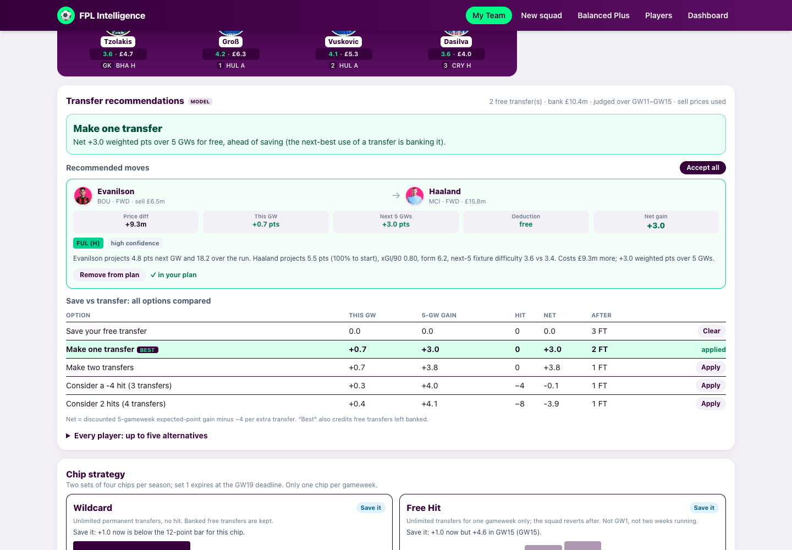

# Gameweek Intelligence Report (PDF)

**Download GW report (PDF)** button: Team Builder and My Team (in the actions card under the pitch). Sample outputs: [`docs/samples/gw11-team-builder-report.pdf`](samples/gw11-team-builder-report.pdf) and [`gw11-my-team-report.pdf`](samples/gw11-my-team-report.pdf).

## What is in the PDF

| Section | Content |
|---|---|
| Header | gameweek, deadline, team name, generation time, optimisation mode, **data freshness** (FPL fetch time, live/cache/sample, stale warning), a FACT vs MODEL legend |
| Squad summary | formation, captain, vice-captain, projected points, squad cost, bank/remaining, overall and starting-XI **model confidence** (high/medium/low counts) |
| How to use for review | a suggested prompt and checklist for an independent FPL review |
| Starting XI and Bench | all **15 players**: position, club, price, ownership, xPts, confidence, start probability, expected minutes, this-GW fixtures with FDR, minutes, goals/assists, xG/xA, form, status/news. Captain (C), vice (V), bench order (B1-B4) |
| Expected-points breakdown | appearance, goals, assists, clean sheet, goals conceded, saves, defensive contribution, bonus, cards, form tilt, total, per player |
| Fixtures | fixtures and projected xPts for the next five gameweeks per player |
| Why selected / warnings | the model's reasons and data-backed warnings per player |
| My Team only | **actual squad** with purchase and selling prices; the proposed plan (transfers, hit, projected points after hit, legality); transfer recommendations (decision, all options with net gain, explanations, sell shortlist); chip strategy (verdict per chip) |
| Team Builder only | the best legal replacements for each player (the builder has no transfers), plus a list of any **manual edits** versus the generated squad |
| Model and limitations | method summary, confidence definition, backtest accuracy, known limits |
| Structured data | the **complete report as JSON text** (`=== BEGIN STRUCTURED DATA (JSON, schema fpl-gw-report/1) ===` ... `=== END ... ===`) |

## Machine-readable by design

1. **Selectable text**: real text with embedded Unicode fonts (DejaVu), so names like Ødegaard, Groß, Gabriel Martinelli extract correctly. No images of tables.
2. **Printed JSON**: the whole report as pretty JSON on the final pages (schema `fpl-gw-report/1`; small objects inline). Line breaks inside long strings are layout wrapping only.
3. **Attached JSON**: the identical document is embedded in the PDF as `fpl-gw{N}-report.json` for tools that read attachments (lossless).
4. **Metadata**: PDF Title, Subject (formation + captain), Keywords, Creator.

Per player the JSON has: id, name, club, position, role (starting/bench), slot, benchOrder, isCaptain, isViceCaptain, priceM, (My Team: purchasePriceM, sellingPriceM), ownershipPct, status, news, `season` (minutes, starts, goals, assists, xG, xA, xGI, per-90, clean sheets, saves, bonus, form, points), `projection` (xPts, confidence, confidenceScore, startProbability, availability, expectedMinutes, fixtures with FDR, `breakdown`), `upcomingFiveGws`, `whySelected`, `warnings`.

### Using it with ChatGPT

Upload the PDF and ask, for example: *"You are an experienced FPL manager. Using only this report, review the squad, starting XI, captain, bench order and any transfer or chip advice for this gameweek. Point out risks, anything the model may have missed, and what you would change and why. Do not invent statistics that are not in the report."* (The same prompt is printed on page 1.)

## It always describes the squad on screen

- The browser sends the squad **as displayed** (XI order, bench order, captain, vice). The server **never regenerates** a squad.
- **Team Builder**: the server validates it against the squad rules (2/5/5/3, 3 per club, budget) and lineup rules (one GK, legal formation, captain/vice in the XI) and returns `422` if illegal. If you swapped players, the PDF lists them under "User edits vs the generated squad".
- **My Team**: the server re-evaluates your season with the same engine as the screen and returns **`409`** if the XI, bench or captains it computes differ from what was sent, so a stale screen can never produce a PDF of a different squad. The PDF shows the **proposed** squad (actual + accepted plan; the temporary squad under a Free Hit) and, separately, the **actual** squad.
- The reported projected points are the same number the screen shows (asserted in the tests).

## API

`POST /api/report` (see [openapi.yaml](openapi.yaml)). Response header `x-report-squad` echoes the 15 ids that the PDF describes.

## Verification

- `tests/report.test.ts` (10 tests): PDF validity and metadata; all 15 names and xPts printed; captain/vice marks, sections, fixtures, FDR, confidence; **printed JSON equals the attached JSON**; JSON completeness (fields, breakdown sums to xPts, 5 gameweeks, 11+4, one C and one V); edited squad reported exactly (ids/order/projected points/cost/edits), actual vs proposed for My Team (transfer, Free Hit, Bench Boost, no plan); 400/409/422 handling.
- `npm run e2e:report`: real browser, clicks **Download**, then validates the downloaded file (see Testing).

## Limitations

- Landscape A4, ~20-27 pages (most are the JSON appendix). Long strings in the printed JSON wrap, so parse the attached JSON if you need exact strings.
- The PDF captures a point in time; projections and FPL data change (the freshness line says when).
- It is a report of model predictions, not a guarantee; availability news beyond FPL's own fields is not known to the model.
- Fonts are read from `node_modules/dejavu-fonts-ttf` at runtime (fine for `next start`/dev; a serverless deploy must include that folder).
