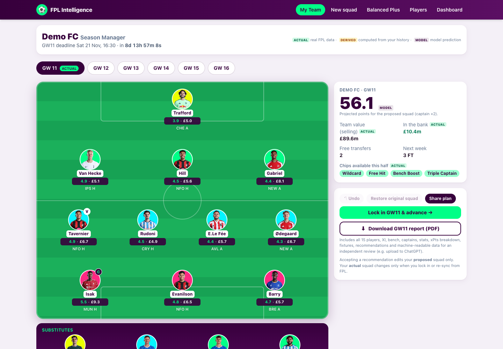

# Season Manager ("My Team")

Turns FPL Intelligence from a one-off squad builder into a season-long manager. The **New squad** builder is unchanged; **My Team** carries a real squad from gameweek to gameweek. See [SEASON_MANAGER_PLAN.md](SEASON_MANAGER_PLAN.md) for what was reused versus added.

## Verified 2026/27 rules (and sources)

| Rule | Implemented as | Verified from |
|---|---|---|
| 1 free transfer per gameweek | `rules.freeTransfersPerGw = 1` | Official FPL rules |
| Bank at most **5** free transfers | `maxFreeTransfers = 1 + game_config.rules.max_extra_free_transfers (4)` | API config; [Premier League: changes for 2026/27](https://www.premierleague.com/en/news/4679873/all-you-need-to-know-about-changes-to-fpl-for-202627) ("roll over up to five") |
| No AFCON top-up transfers | none added | same article |
| −4 points per transfer beyond the free allowance | `transferHit = 4` (constant; **the API does not expose it**) | Official FPL rules |
| Selling price | buy + ⌊profit × 0.5⌋ (0.1m steps), losses in full | API `transfers_sell_on_fee = 0.5`, `element_sell_at_purchase_price = false` |
| Squad / budget / club limit | 15 / £100m / 3 | API `game_config.rules` |
| Chips | Wildcard, Free Hit, Bench Boost, Triple Captain, **two sets** (first usable before the GW19 deadline, second GW20–38, unused first-half chips are lost) | API `chips[]` windows; [PL chips article](https://www.premierleague.com/en/news/4679879/whats-happening-with-fpl-chips-in-202627) |
| One chip per gameweek | enforced in `chipErrors` | PL chips article |
| Free Hit not in GW1; not in two consecutive gameweeks | enforced | PL chips article; API (`freehit` starts GW2) |
| Wildcard: unlimited **permanent** transfers; Free Hit: unlimited transfers for **one gameweek**, squad reverts | `applyPlan` / `rollForward` | PL chips article |
| Banked free transfers survive Wildcard / Free Hit | policy: unchanged, no new one accrued that week | **Secondhand**: Fantasy Football Scout quoting the FPL site. The PL articles do not state it. Flagged here and in code (`nextFreeTransfers`); change that one function if FPL clarifies otherwise |

Where the brief and the API differ: the API has **no field for the transfer hit or for free transfers**, so the hit is a documented constant and free transfers for an imported team are **derived** (see Import).

## Three separate squad states

| State | Where | Rule |
|---|---|---|
| **Actual** | `state.actual` | Changes only by *Lock in* (after the deadline) or *Re-sync from FPL*. A recommendation can never overwrite it (asserted in the E2E test) |
| **Proposed** | `state.plans[gw]` applied to the actual squad | Accept/reject, replacements, Wildcard, Bench Boost, Triple Captain live here |
| **Free Hit** | `plans[gw].freeHitIds` | Temporary 15; the permanent squad is untouched and returns automatically (`rollForward`) |

Moving from GW11 to GW12 does **not** regenerate a team: `rollForward` applies each earlier gameweek's accepted plan to the actual squad, rolls free transfers, and the new gameweek's fixtures, availability and projections are loaded on top.

## Transfer optimiser (`lib/season/transfers.ts`)

- **Legality is deterministic** (`applyPlan`): selling prices, bank ≥ 0, 15 players with 2/5/5/3, ≤3 per club, selectable players, free transfers/hits, chip rules. No model decides legality.
- **Value** of a squad = best XI + captain re-chosen every gameweek, summed over the next five gameweeks with discount 1 / .9 / .8 / .7 / .6 (uses the existing projection engine, injuries/minutes/xG/xA/form/fixtures included).
- **Search**: every legal single swap for all 15 players (feeds the "up to five alternatives per player" list), then a beam search (width 6) for 2, 3 and 4 transfers.
- **Net gain** = Σ discounted expected points after − before − 4 × hits. Per-transfer rows show this-GW gain, 5-GW gain, deduction and net.
- **Save vs use**: each option scores `net + bankValue(free transfers left)`; banking is worth ~1.2 pts per extra banked transfer up to 3, then 0.4 (a tunable heuristic, 0 at the cap of 5). A transfer is recommended only if it beats saving by ≥ 0.5 pts, a hit by ≥ 2.0. An already-strong squad is told to **save**; the engine never forces a move.
- Differentials (<10% owned) are flagged; they do not inflate the expected points.

Labels produced: "Save your free transfer(s)", "Make one transfer", "Make two transfers", "Consider a −4 hit (3 transfers)", "Consider two hits (4 transfers)".

## Chips (`lib/season/chips.ts`)

| Chip | Points effect | Gain estimate |
|---|---|---|
| Bench Boost | all 15 count | expected points of the 4 bench players |
| Triple Captain | captain ×3 | captain's expected points |
| Free Hit | temporary optimal squad, budget = selling prices + bank | FH squad XI points − current squad XI points |
| Wildcard | permanent optimal rebuild over 5 GWs, same budget | weighted gain minus the best ordinary-transfer net (credited only for what transfers cannot do) |

Strategy: for each available chip, gain is estimated for every remaining candidate gameweek (Free Hit 5 ahead, others 8 ahead; Wildcard now only), including doubles/blanks from the fixture list. Verdicts: **use now** (gain ≥ threshold BB 8 / TC 7 / FH 14 / WC 12 and within 10% of the best window), **save** (names the better gameweek), **use before it expires** (≤3 gameweeks left: steered to the best remaining week). Bench Boost / Triple Captain estimates assume your current squad (labelled in the UI).

## Import an FPL team (`/api/import/{teamId}`)

Public endpoints only, **no password, cookie or login**: `entry/{id}/`, `/history/`, `/transfers/`, `/event/{gw}/picks/`.

| Field | Source | Status |
|---|---|---|
| Squad | picks of the current gameweek + transfers queued for the next | actual |
| Purchase prices | opening squad: price in GW`started_event` (element-summary); later buys: `element_in_cost` from transfer history; Free Hit weeks ignored | actual (rebuilt) |
| Bank | `history.current[].bank` of the last finished GW (before any Free Hit) + queued transfers | actual |
| Team value | selling prices of the 15 (what you could raise) | actual |
| Captain / vice | last picks | actual |
| Chips used | `history.chips` | actual |
| Transfer history, per-GW points | `transfers`, `history.current` | actual |
| **Free transfers** | replay of per-GW transfer counts + chips under the rules above | **derived**: manual override in Team settings |

Validation against live data: a real public team rebuilt with no warnings, bank equal to FPL's, chips matching. FPL's own `value` field (e.g. £102.5m) equals the **market** value of the 15 plus the bank, not selling prices; the UI shows selling value and explains the difference in the tooltip. If the rebuilt squad ever disagrees with the picks, the import falls back to picks with current prices and says so.

Manual entry: *Start from recommended squad*, then Team settings for bank, free transfers and chips used.

## History and tracking

Stored in the browser (versioned `localStorage`, exportable as JSON): locked squads per gameweek, proposed vs accepted transfers, recommendation log (pending / accepted / rejected), chip usage, pre-deadline prediction and actual points. Predictions are written once at lock-in and never back-filled. Actual points are filled from the FPL history (net of hits) or typed in; the panel shows mean absolute error and bias of the model on *your* locked squads. Friends: **Share plan** reuses the stateless share link and image for the proposed squad.

## API

`POST /api/season/{evaluate,transfers,chips,alternatives,freehit,wildcard,commit}`, `GET /api/import/{teamId}`; documented in [openapi.yaml](openapi.yaml). All are stateless: the client sends `{ season: { actual, plans }, gw }`.

## Limitations

- Future prices are not predicted: selling uses today's prices.
- Bench Boost / Triple Captain future-gameweek estimates assume today's squad.
- Wildcard timing is judged for *now* only.
- 4-transfer search is a beam search, not an exhaustive optimum (single and double moves are effectively exhaustive within the candidate pool).
- Projections are estimates with a confidence indicator, not guarantees.
